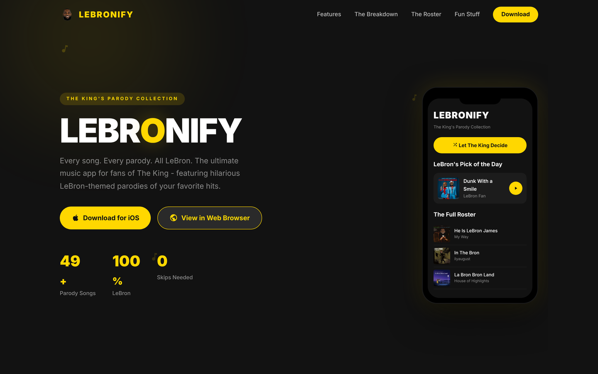
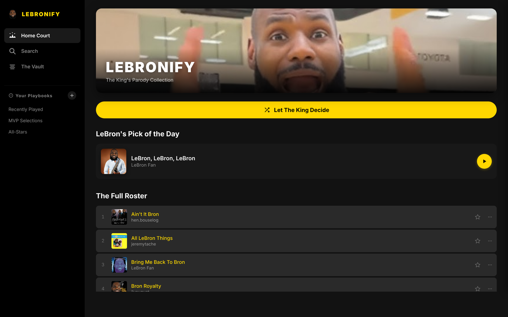
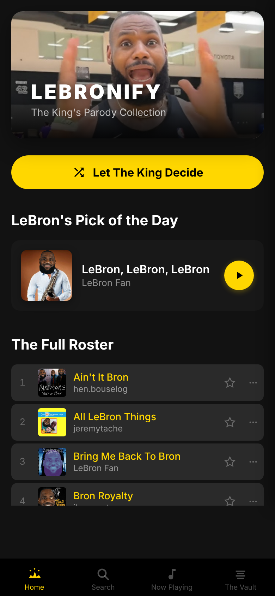

<h1 align="center">👑 LeBronify</h1>

  <b>Every song. Every parody. All LeBron.</b> 
  A parody music player for iOS, built for fans of The King and absolutely no one else.

  

## What is this

LeBronify is a Spotify-style music app where the entire catalog is LeBron James parody songs. You get a Home Court,
a search, The Vault, playlists ("Playbooks"), a LeBron Pick of the Day, and a big yellow **Let The King Decide** shuffle button.

There are ads, too. They're all Anthony Davis, and they're mostly injury jokes.

  
  &nbsp;
  

## Features

- 🎵 **The full roster**: dozens of LeBron parody tracks with album art, favorites and recently played
- 🎲 **Let The King Decide**: one-tap shuffle, plus a daily pick
- 📚 **Playbooks**: make your own playlists
- 🏝️ **Dynamic Island + Live Activities**: now-playing controls on your lock screen and in the Dynamic Island
- 🧩 **Home screen widgets** for what's playing and recently played
- 📺 **"Ads" by AD**: interruptions from Anthony Davis that nobody can skip (they're short, he'd get hurt)
- 🌐 **Web version** in [`website/`](website): a landing page plus a playable browser build of the app

## Stack

SwiftUI · AVFoundation · ActivityKit (Live Activities / Dynamic Island) · WidgetKit · plain HTML/CSS/JS for the web build

## Run it

Open `LeBronify.xcodeproj` in Xcode and run the **LeBronify** scheme. The web version is static: open `website/index.html`, or serve the folder with any static server.

## Credits

The parody songs belong to the creators named in each track's title. LeBronify is a fan project and isn't affiliated with LeBron James, the NBA or Spotify.
